<div align="center">


# Tesla Charge Control

**Charge your Tesla from the sun: locally, safely, automatically.**

A Raspberry Pi watches a Deye hybrid inverter and a Tesla Wall Connector, and drives the car's charging current over Bluetooth so it soaks up solar surplus without ever overloading the inverter or draining the home battery.

[](go.mod) [](LICENSE) [](docs/deployment.md) [](Dockerfile) [](https://github.com/teslamotors/vehicle-command) [](https://www.deyeinverter.com/) [](docs/deployment.md#part-6-remote-access-with-cloudflare-optional) [](#how-it-works)

[Features](#features) · [Try the demo](#try-it-in-60-seconds) · [How it works](#how-it-works) · [Hardware](#hardware) · [Deploy](#deployment) · [Architecture](docs/architecture.md)

<br>

<picture>
  <source media="(prefers-color-scheme: dark)" srcset="docs/images/dashboard-dark.png">
  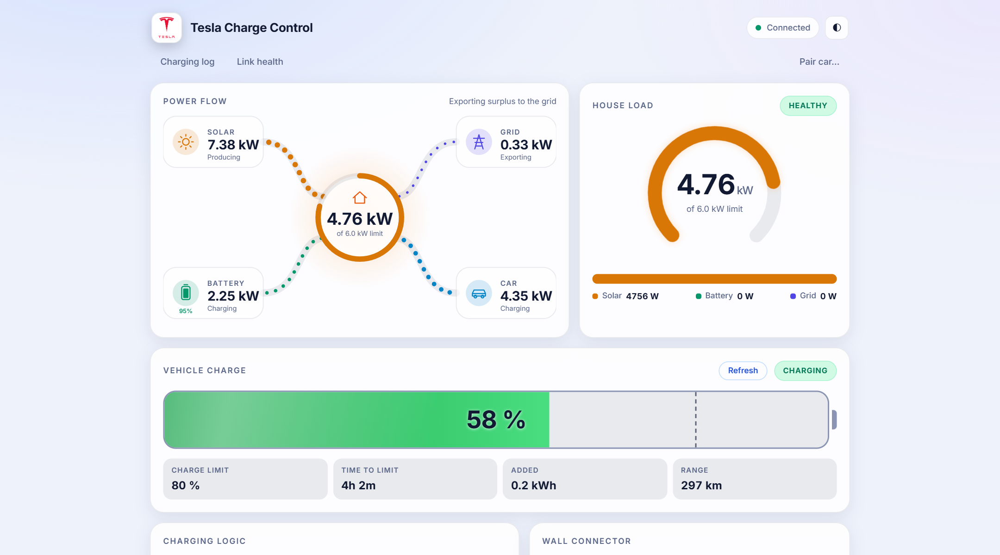
</picture>

</div>

> 🚗 **Thinking about a Tesla?** Ordering through my referral link, **[ts.la/valer120533](https://ts.la/valer120533)**, gets you whatever Tesla's referral program currently offers in your market, and it supports this project (I'm rewarded too). Ordering later or in a store? Enter the code `valer120533`.

---

## Why

A 6 kW hybrid inverter, 8 kWp of panels and a 10 kWh battery produce more than a house can use on a sunny day, and the surplus is exported for next to nothing. The car is the biggest battery you own. But charging it naively is risky: a Tesla on a wall connector draws up to 5.7 kW, and the moment the oven switches on, the inverter is past its limit. When the grid fails, a charging car would empty the home battery that is meant to keep the lights on.

Tesla Charge Control closes that loop every five seconds. It reads what the inverter is really exporting, what the car is really drawing, and adjusts the charging current over Bluetooth, from 5 A to the wall connector's maximum, without a Tesla account, a cloud API or an internet connection.

## Features

<table>
<tr>
<td width="50%" valign="top">

**☀️ Solar-surplus charging**<br>
Follows the real grid export, smoothed over 90 s, with a start delay, a grace period for passing clouds and a contactor-friendly cooldown.

**🔋 Four modes, one tap**<br>
*Idle* (the car's own schedule), *Solar: battery first*, *Solar: car first*, and *Max*. The choice survives restarts; unplugging returns to Idle.

**⚡ Never overload the inverter**<br>
The whole home load is kept under the inverter's maximum in **every** mode, budgeted in amps at the *measured* voltage. Urgent reductions jump the queue; a 15 s backstop stops the car if one doesn't land.

**🛡️ Fail safe**<br>
Grid outage → the car stops, so the battery keeps the house running. Inverter data lost → the car stops. Both resume by themselves.

</td>
<td width="50%" valign="top">

**📡 Local Bluetooth control**<br>
Tesla's official [vehicle-command](https://github.com/teslamotors/vehicle-command) protocol, paired as a phone key from the dashboard. Proactive wake-ups, an async newest-wins command queue, back-off on a weak link.

**📊 A dashboard you'll actually look at**<br>
Animated power flow, live over SSE, dark and light themes, works on a phone. A decision log explains every change; link-health gauges show the last 24 h of the inverter and wall-connector links.

**🌍 Remote access without open ports**<br>
Optional Cloudflare Tunnel behind Cloudflare Access, with the app re-verifying the Access token itself. One script sets it all up.

**🧪 Try it without hardware**<br>
`-demo` runs the real control logic against a simulated sunny afternoon: inverter, wall connector and car.

</td>
</tr>
</table>

## Screenshots

<table>
<tr>
<td width="50%">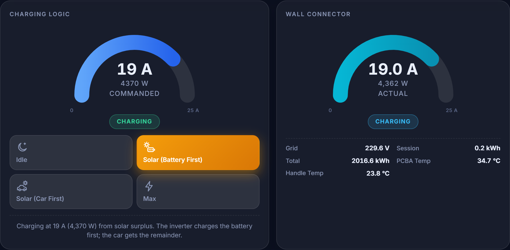<p align="center"><sub><b>Charging logic</b>: commanded vs. actual current, four modes and a plain-language reason</sub></p></td>
<td width="50%">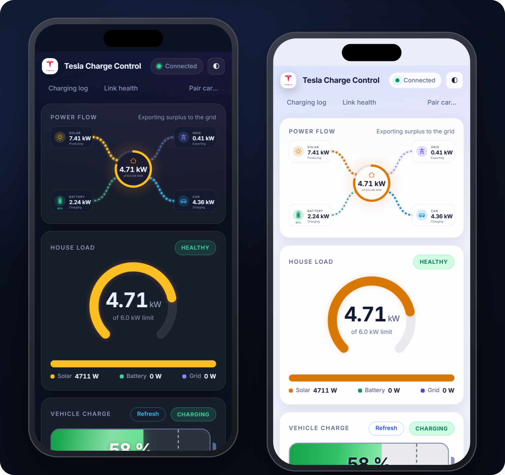<p align="center"><sub><b>On your phone</b>: dark and light themes follow the system</sub></p></td>
</tr>
<tr>
<td width="50%">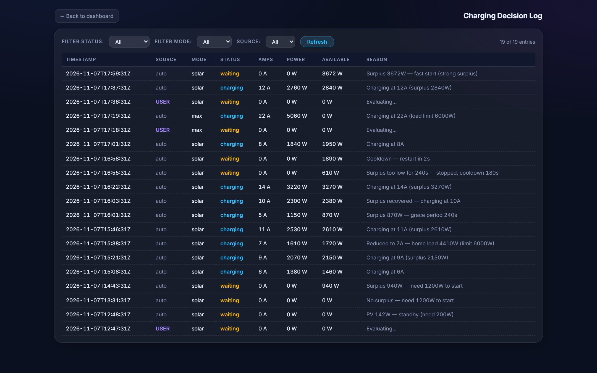<p align="center"><sub><b>Decision log</b>: every change with the surplus and the reason behind it</sub></p></td>
<td width="50%">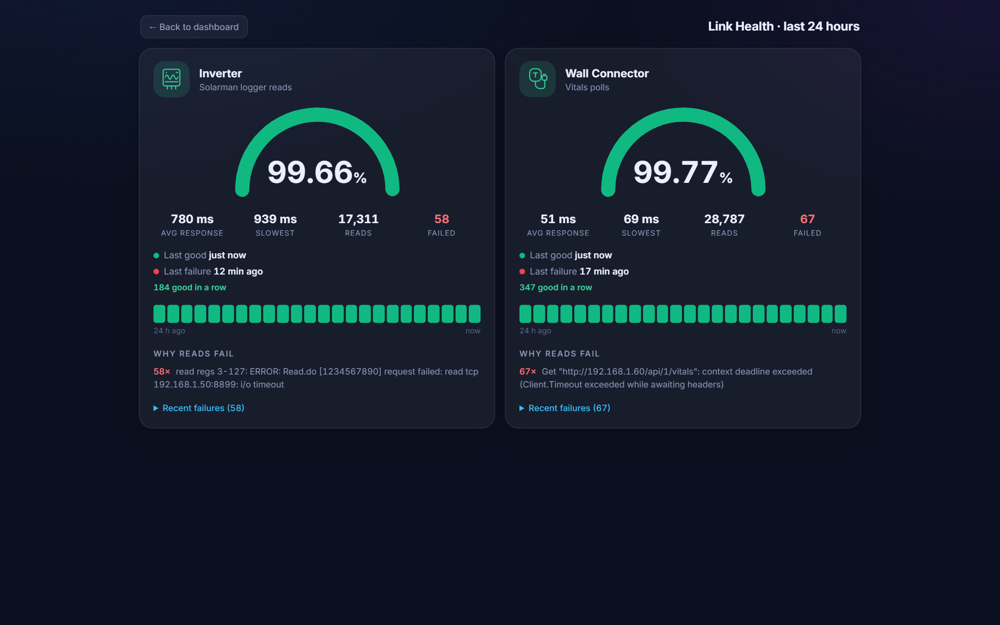<p align="center"><sub><b>Link health</b>: 24 h success rate, latency and failure reasons</sub></p></td>
</tr>
<tr>
<td width="50%">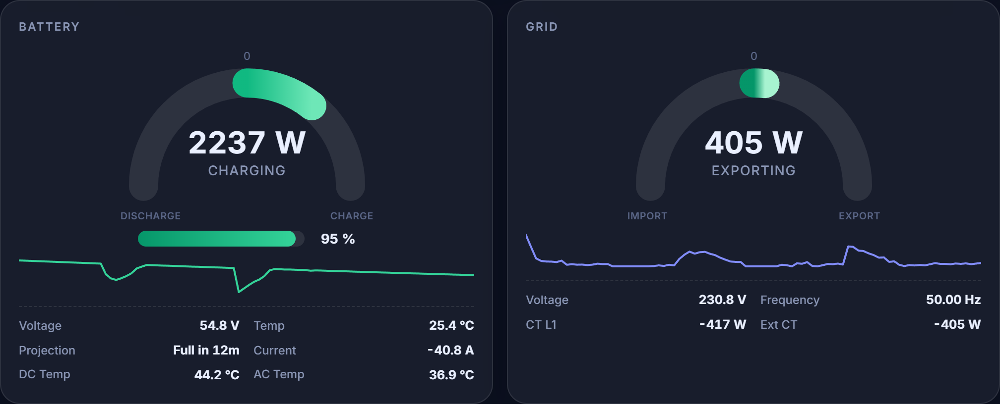<p align="center"><sub><b>Inverter detail</b>: battery, grid, both PV strings and AC output with live sparklines</sub></p></td>
<td width="50%">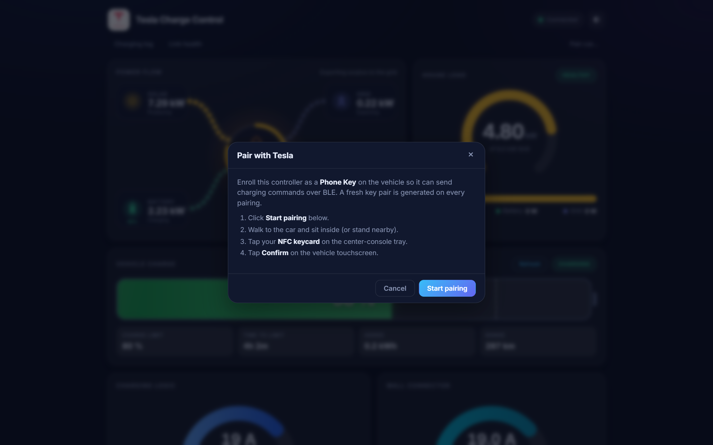<p align="center"><sub><b>One-click pairing</b>: enrol the Pi as a key with your key card</sub></p></td>
</tr>
</table>

<details>
<summary><b>Full dashboard</b> (dark and light)</summary>
<br>
<p align="center">
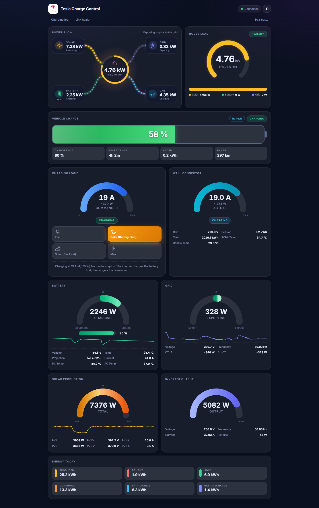
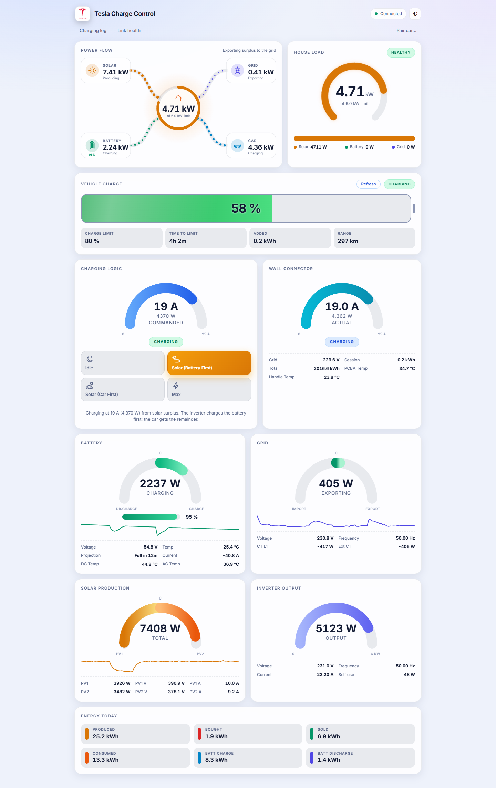
</p>
</details>

## Try it in 60 seconds

No inverter, no wall connector, no car: just Docker.

```bash
git clone https://github.com/vbocan/tesla-charge-control.git
cd tesla-charge-control
docker compose up --build
```

Open <http://localhost:8080>. It's 12:40 on a sunny day: the home battery is nearly full, Solar mode notices the export and starts the car within a minute, a cloud passes, a kettle boils, and the charging current follows. Switch modes, open the log, watch the load cap at work. Everything you see is the production control code in dry-run mode; only the inverter, the wall connector and the car are simulated.

## How it works

<picture>
  <source media="(prefers-color-scheme: dark)" srcset="docs/images/architecture-dark.svg">
  
</picture>

Every 5 seconds the Pi reads the inverter and decides; the wall connector is polled every 3 s in the background, and commands go to the car through a single-slot queue so a slow Bluetooth link never stalls the loop.

**The surplus** is what the inverter is *exporting*, plus what the car is already drawing (its draw is what reduced the export):

| Mode | Surplus | In practice |
|---|---|---|
| **Solar (Battery First)** | `export + car − battery discharge` | The Deye fills the home battery first; the car gets what's left. Default. |
| **Solar (Car First)** | `export + car − battery net flow` | PV goes to the car ahead of the home battery; the grid covers dips. |
| **Max** | — | As fast as the inverter budget allows, from any source. |
| **Idle** | — | The car follows its own schedule; the Pi only keeps the load under the limit. |

**Then the load cap has the last word**, in every mode:

```
car amps ≤ (max_output_w − margin − house load without the car) / measured voltage
```

Below 5 A there is nothing to reduce to, so the car stops (or holds 5 A in Max if it physically fits). A grid outage or 2 minutes without inverter data stop it too. The [architecture document](docs/architecture.md) covers the state machine, the BLE pipeline, the safety layers and the 15 design decisions behind them.

## Hardware

| | Developed with | Compatible |
|---|---|---|
| Inverter | **Deye SUN-6K-SG03LP1-EU** + Solarman Wi-Fi logger | Deye/Sunsynk single-phase hybrids with the same register map |
| Wall connector | **Tesla Wall Connector Gen 3** | Optional but recommended (real current, contactor, voltage) |
| Car | **Tesla Model Y** | Any Tesla supported by vehicle-command over BLE |
| Controller | **Raspberry Pi Zero 2 W** | Any 64-bit Linux box with Bluetooth, parked within range of the car |
| Remote access | **Cloudflare** (free Zero Trust plan) | Optional; Caddy + Let's Encrypt also supported |

## Deployment

The full walkthrough, from flashing the SD card to Cloudflare Access, is in **[docs/deployment.md](docs/deployment.md)**. In short:

**1. Prepare the Pi**: Raspberry Pi OS Lite 64-bit, SSH, Docker, Bluetooth on.

```bash
curl -fsSL https://get.docker.com | sh && sudo usermod -aG docker $USER
```

**2. Configure**: on your workstation:

```bash
cp config.example.yaml config.yaml    # logger IP + serial, VIN, wall connector IP, inverter limits
```

**3. Build and deploy**: the image is cross-built for ARM64 on your machine and shipped over SSH; the Pi never compiles anything.

```bash
./deploy.sh pi@192.168.1.100          # Linux / macOS
```

```powershell
.\deploy.ps1 pi@192.168.1.100         # Windows
```

**4. Pair the car**: open `http://<pi>:8080`, click **Pair car…**, tap your key card on the console.

**5. Go live**: set `dry_run: false`, deploy again, choose **Solar**.

**6. Remote access (optional)**: one command creates the Cloudflare Tunnel, DNS record, Access application and policy, and wires the token into the Pi:

```powershell
.\deploy\cloudflare-setup.ps1 -Hostname solar.example.com -Email you@example.com -RpiHost pi@192.168.1.100
```

| Lives on the Pi | Purpose |
|---|---|
| `/opt/deye-monitor/config.yaml` | Your configuration (copied on every deploy) |
| `/opt/deye-monitor/.env` | `TZ`, `TUNNEL_TOKEN`: yours, never touched by deploys |
| volume `tesla-state` → `/state` | BLE key pair, selected mode, SQLite logs. Back up the key. |

## Safety

This software sends charging commands to a car connected to a high-current circuit. It is built to fail safe, and its limits are documented:

<p align="center">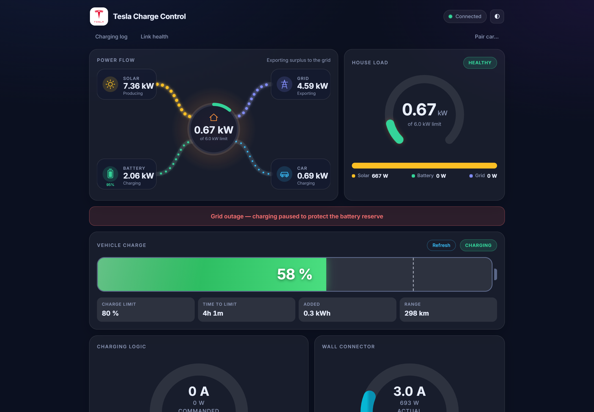<br><sub>A (simulated) grid outage: the car is stopped at once and charging resumes on its own once the grid has been stable for five minutes.</sub></p>

- The inverter limit is enforced in every mode, with an overload backstop.
- Grid outages and lost inverter data stop the car; both resume automatically.
- A dry-run mode makes every decision without sending a command; start there.
- The wall connector and the car keep their own protections; this software only ever asks for **less** than they allow.
- Every stop is a Bluetooth command: if the Pi can't reach the car, it can't stop it. The dashboard shows when the car isn't reachable.

Use at your own risk; see the [license](LICENSE).

## Development

```bash
go build ./... && go test -race ./...    # Go 1.26+, Linux or macOS
go run ./server -demo                    # the dashboard at http://localhost:8080
```

No Go toolchain? Everything also builds in Docker:

```bash
docker run --rm -v "$PWD:/src" -w /src golang:1.26-alpine sh -c "apk add -q build-base && go vet ./... && CGO_ENABLED=1 go test -race ./..."
```

```
server/   HTTP server, SSE, auth, demo simulator, embedded web UI (server/web)
tesla/    charging brain: modes, state machine, load cap, outage guard, BLE queue, wall connector, SQLite
deye/     Solarman/Modbus reader, register map, config
linkstat/ 24-hour link-health tracker
deploy/   production compose files and Cloudflare automation
docs/     architecture and deployment guides
```

The UI is plain HTML/CSS/JS embedded in the binary: edit `server/web/`, run with `-demo`, refresh.

## FAQ

<details>
<summary><b>Do I need a Tesla developer account or the Fleet API?</b></summary>

No. Commands go straight to the car over Bluetooth with a key you enrol yourself, the same way the Tesla app works as a phone key. Nothing touches Tesla's servers.
</details>

<details>
<summary><b>Can I use it without a Tesla Wall Connector?</b></summary>

Yes, with reduced precision: the car's draw is estimated from the commanded current, and features that need the contactor state (detecting unplugging, the Idle-mode load guard) are unavailable.
</details>

<details>
<summary><b>Does it work with other inverters?</b></summary>

It was built for the Deye SUN-6K-SG03LP1-EU. Other Deye and Sunsynk single-phase hybrids with a Solarman logger use largely the same registers. Other brands need a new reader behind the small `inverterSource` interface. Contributions welcome.
</details>

<details>
<summary><b>How far can the Pi be from the car?</b></summary>

Closer than you'd think it needs to be: through a wall or garage door, aim for a signal of −70 dBm or better. The [troubleshooting guide](docs/deployment.md#troubleshooting) shows how to measure it.
</details>

<details>
<summary><b>Will it keep my car awake or drain its 12 V battery?</b></summary>

It is designed not to. Battery-level reads are deliberately sparse (every 20 minutes while plugged in and idle, every minute while charging; both configurable) so a parked car can still sleep, and when the car is unplugged it isn't contacted at all. A full wake-up is only sent shortly before a charge starts.
</details>

## Acknowledgements

- [teslamotors/vehicle-command](https://github.com/teslamotors/vehicle-command): Tesla's Go library for signed vehicle commands over BLE
- [snowirbis/solarman](https://github.com/snowirbis/solarman): Solarman V5 protocol client
- [modernc.org/sqlite](https://gitlab.com/cznic/sqlite): SQLite in pure Go, which keeps the build CGO-free
- [Simple Icons](https://simpleicons.org/) for the brand marks in the architecture diagram

Tesla, Deye, Raspberry Pi, Cloudflare, Docker and their logos are trademarks of their respective owners. This project is independent and not affiliated with, endorsed or sponsored by any of them; names and logos are used only to identify compatible products.

## License

[MIT](LICENSE) © [Valer Bocan](https://www.bocan.ro)
