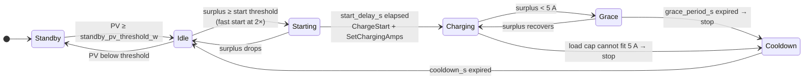

# Architecture

This document explains how Tesla Charge Control works and why it is built the way it is. It is the single reference for the control logic, the safety layers and the design decisions; the [README](../README.md) covers what it does and [deployment.md](deployment.md) covers how to install it.

- [1. Goals](#1-goals)
- [2. System overview](#2-system-overview)
- [3. Runtime model](#3-runtime-model)
- [4. Charging modes](#4-charging-modes)
- [5. The Solar state machine](#5-the-solar-state-machine)
- [6. Safety layers](#6-safety-layers)
- [7. Talking to the car](#7-talking-to-the-car)
- [8. Reading the inverter and the wall connector](#8-reading-the-inverter-and-the-wall-connector)
- [9. Remote access and security](#9-remote-access-and-security)
- [10. Persistence and logging](#10-persistence-and-logging)
- [11. Web dashboard](#11-web-dashboard)
- [12. Demo mode](#12-demo-mode)
- [13. Code map](#13-code-map)
- [14. Architectural decisions](#14-architectural-decisions)
- [15. Limitations and future work](#15-limitations-and-future-work)

---

## 1. Goals

1. **Charge the car from sunshine that would otherwise be exported**, following the surplus as clouds pass and appliances switch on and off.
2. **Never overload the inverter.** A 6 kW hybrid inverter running the whole house plus a 5.7 kW car is one kettle away from tripping. The inverter's maximum output is a hard budget in every mode.
3. **Never drain the home battery into the car by accident**, and never charge the car from the battery while the grid is down.
4. **Fail safe.** If the Pi loses sight of the inverter, the grid, or the car, it stops the car rather than guess.
5. **Stay local.** No Tesla account, no cloud API, no rate limits, no subscription. The internet is only needed for optional remote access.
6. **Explain itself.** Every decision is logged with the numbers that drove it, so any behaviour can be reconstructed afterwards.

## 2. System overview

<picture>
  <source media="(prefers-color-scheme: dark)" srcset="images/architecture-dark.svg">
  
</picture>

| Component | Role | Link |
|---|---|---|
| **Deye SUN-6K-SG03LP1** hybrid inverter + Solarman Wi-Fi logger | Source of truth for PV, battery, grid and house load | Solarman V5 (Modbus over TCP 8899), LAN |
| **Tesla Wall Connector Gen 3** | The car's real current, contactor state, mains voltage | Local HTTP API (`/api/1/vitals`, `/api/1/lifetime`), LAN |
| **Tesla** (developed on a Model Y) | Receives wake / start / stop / set-amps; reports SoC | Bluetooth LE, Tesla's [vehicle-command](https://github.com/teslamotors/vehicle-command) protocol |
| **Raspberry Pi Zero 2 W** | Runs the controller in Docker, within BLE range of the car | — |
| **Cloudflare Tunnel + Access** (optional) | Remote access without opening ports | Outbound QUIC from `cloudflared` on the Pi |

The controller is one Go binary with the dashboard embedded. It reads, decides and commands in a loop; everything else (the dashboard, logs, link health) observes that loop.

## 3. Runtime model

### 3.1 Goroutines

| Goroutine | Cadence | Job |
|---|---|---|
| Poll loop (`server.pollLoop`) | `poll_interval_s` (5 s) | Read the inverter → `Charger.Evaluate` → broadcast to dashboards via SSE. Exponential back-off (2 s → 30 s) while the inverter read fails. |
| Wall Connector poller (`TWCClient.Run`) | 3 s (lifetime: 60 s) | Keep the latest vitals in memory; the charger reads them, never waits on the network. |
| BLE worker (`Charger.RunBLEWorker`) | on demand | Execute the one pending car command. |
| SoC poller (`Charger.RunSoCPoller`) | 60 s charging, 20 min plugged in | Read the car's battery level over BLE, out of the control path's way. |
| Watchdog (`Charger.RunWatchdog`) | 5 s | Stop the car when inverter data goes stale (see §6.4). |

### 3.2 One control cycle

`Charger.Evaluate(data)` never touches the radio. Each cycle:

1. Record that inverter data arrived; track grid health (outage detection, §6.3).
2. **Car unplugged?** (wall connector says no vehicle) → switch to Idle, forget the cached SoC, done.
3. **Paused** (grid outage, restoring, or blind)? → enforce the stop, done.
4. **Idle mode** → run the Idle load guard (§6.5), done.
5. Compute the **surplus** for the active mode (§4).
6. Run the mode logic: the Solar state machine (§5) or Max.
7. Apply the **load cap** (§6.1). It always has the last word.
8. Queue the single resulting car command (`flushOp`) and log the decision if status or current changed.

The `send*` helpers only record *intent* in `cycleOp`; merging happens within the cycle so a later safety reduction overrides an earlier mode decision. The command is handed to the BLE queue once, at the end.

## 4. Charging modes

| Mode | UI label | Who decides to charge | Surplus signal |
|---|---|---|---|
| `idle` | Idle | The car (its schedule, or plug-in) | — (Pi only guards the load limit) |
| `solar` | Solar (Battery First) | The Pi | `export + carW − batteryDischarge` |
| `nobattery` | Solar (Car First) | The Pi | `export + carW − batteryPower` |
| `max` | Max | The Pi | — (as much as the inverter budget allows) |

**Why export-based?** Grid export is what the inverter pushes out *after* it has served the house and the battery, according to its own priorities. Feeding the car only from export means the Deye keeps charging the battery first, with no need to model its logic. The car's own draw is added back so the formula stays stable once the car is charging (its draw is what reduced the export).

- **Battery First** subtracts battery *discharge*: if the inverter starts draining the battery to cover the car, the surplus shrinks and the car backs off. Without that term the car's consumption masquerades as surplus and the battery silently empties.
- **Car First** subtracts the battery's *net* flow (charging adds, discharging subtracts), so energy that would top up the home battery goes to the car instead, while the grid, not the battery, covers any shortfall. Export is still included so the loop has a signal once the battery is full.
- **Max** charges at the highest current the inverter budget allows, from any source. It raises the current only when there is room for at least 2 A more (`maxRaiseDeadbandAmps`) so the target doesn't flip-flop, and after a load-cap stop it holds off 60 s before restarting.

**At the charge limit.** A car at (or above) its charge limit answers ChargeStart with "complete". That is a normal state, not a fault: every charging mode goes idle ("Car at its charge limit (60%)") and stops sending starts. It asks again only when something changes: the wall connector shows the car charging by itself, a SoC reading taken *after* the refusal shows a raised limit or a battery below the limit that the car no longer calls complete, the mode is chosen again, or the car is unplugged. Without a fresh reading the car is not asked again, so at worst it is asked once per SoC poll. In Idle mode the guard gives up restarting a stopped charge the car refuses as complete.

The selected mode survives restarts (`state_file`). Unplugging the car always returns to Idle.

## 5. The Solar state machine

Both Solar modes share one state machine. Thresholds use the 5 A minimum Tesla charging current: the start threshold is `5 A × grid_voltage + 50 W` (1 200 W at 230 V).



| State | Behaviour |
|---|---|
| **Standby** | PV below `standby_pv_threshold_w` (night, heavy overcast). No decisions. |
| **Idle** | Collect surplus samples. If the car is found charging anyway (a stop that never reached it), *adopt* the session when the surplus supports it, otherwise stop it. |
| **Starting** | Sustained surplus for `start_delay_s`. On entry a **proactive BLE wake** is sent (§7.3) so the car is awake when the delay ends. A single-cycle dip is tolerated; two in a row reset to Idle. |
| **Charging** | Each cycle the current follows the surplus: `amps = effectiveW / voltage`, clamped to 5…`max_amps`. A failed start is retried in place (paced by the queue's back-off) instead of waiting out a new start delay. If the contactor doesn't close, the start is retried. |
| **Grace** | Surplus fell below 5 A: hold at 5 A for `grace_period_s` to ride out a cloud. |
| **Cooldown** | Just stopped. No restart for `cooldown_s`, to protect the contactor. |

**Smoothing.** A rolling average over `smoothing_window_s`. The value acted on is `min(smoothed, instantaneous)`: fast to fall (a collapse in surplus is honoured at once), slow to rise (a spike must persist before the current goes up). Integer truncation of `W / V` gives a natural ~1 A safety margin.

## 6. Safety layers

Listed from the most frequent to the rarest. All except 6.5 apply in every mode.

### 6.1 Inverter load cap

```
limitW  = max_output_w − load_margin_w
houseW  = load − carW                      # the house without the car
maxAmps = clamp((limitW − houseW) / volts, 0, max_amps)
```

- `maxAmps ≥ 5` and below the current → an **urgent** reduction.
- `maxAmps < 5` → stop (Solar modes advance to Cooldown so they don't immediately re-issue amps). Max mode holds at 5 A unless even 5 A would exceed the real `max_output_w`.
- **Overload backstop:** if the home load stays above `max_output_w` for 15 s while charging (a reduction that never landed), stop.

**Measured voltage.** Mains sags under load (215 V at the wall connector against 230 V nominal). Converting headroom with the nominal figure overestimates what one amp costs and leaves capacity idle, so the cap and Max mode use the wall connector's voltage, then the inverter's, then `grid_voltage`, ignoring readings more than 20 % from nominal.

**Timing.** The inverter is read every 5 s and a BLE command takes a few seconds, so a 2–3 kW appliance can exceed the limit for a few seconds whatever the margin. The margin absorbs small swings; the backstop handles a reduction that fails.

### 6.2 Contactor protection

Grace period, cooldown, the start delay and Max mode's raise deadband and 60 s resume hold-off all exist to keep the contactor from cycling.

### 6.3 Grid outage pause

When the grid fails, the inverter runs the house from the battery; a car charging at 5 kW would empty the reserve meant for the house. So while the grid is down, charging is **stopped and blocked in every mode** (`tesla/outage.go`).

- **Detection:** grid voltage < 80 % of nominal, or no grid frequency, for ≥ 10 s over ≥ 2 samples. Readings with no battery voltage (a failed read) or a frequency outside both ~0 and 45–55 Hz (a garbled frame) are ignored, neither counting towards an outage nor resetting one.
- **Pause:** an urgent stop on entry, re-sent while the wall connector shows the contactor closed (every 60 s without a wall connector).
- **Resume:** after the grid has been normal for `grid_restore_delay_s` (relapses restart the countdown), from a fresh state with a wake first.
- **Test it:** `POST /api/debug/outage?on=true` simulates an outage end-to-end on the real car (it ends by itself after 10 min).

### 6.4 Blind stop (no inverter data)

Without inverter data the Pi can neither enforce the load cap nor see an outage. After `inverter_stale_stop_s` (120 s) without a successful read, the watchdog stops the car over Bluetooth (which needs no network) and charging resumes when data returns. Idle mode is exempt: the logger drops out briefly several times a night and stopping there would cut short a charge the car scheduled itself.

### 6.5 Idle-mode load guard

In Idle mode the car charges on its own schedule, but the inverter still has to stay under its limit. With `idle_load_cap: true`:

- The guard **never starts a charge**. It acts only once the wall connector shows the contactor closed.
- Its ceiling is the car's own current setting. A Bluetooth reading counts only if it was taken after the Pi last set a current; otherwise the guard asks the car right away. Until the answer arrives, it works from what the wall connector measures the car drawing, since a car can't draw more than its setting. A reading that arrives after the guard has changed the current is ignored: it would only echo the Pi's own value.
- The §6.1 cap applies: reduce when the house needs room, raise again (never above the ceiling) when there is room for 2 A more, stop only if even 5 A doesn't fit.
- A charge the guard stopped (overload, outage) is **restarted** by the guard once there is room / the grid is stable, since the car would not resume it. If the contactor hasn't closed after 2 minutes the guard gives up. A charge the car ended itself is left alone.
- When the session ends, a current setting the guard changed is **restored**, because the car plans its next scheduled charge with whatever it was last told. It goes back to the setting it read, or, if that was never read, to the most the car was measured drawing. A stop alone changes no setting, so nothing is restored after one.

### 6.6 What cannot be covered

Every stop is a Bluetooth command. If the Pi cannot reach the car, nothing can stop it. The dashboard makes that visible ("Not reachable" on the vehicle card, an error status), and placement of the Pi near the car matters (see the troubleshooting section of the deployment guide).

## 7. Talking to the car

### 7.1 Asynchronous command queue

Bluetooth is slow and sometimes flaky; the control loop must never wait for it. `tesla/blequeue.go` is a **single-slot, newest-wins** queue drained by one worker:

- Only the latest wanted state matters. If a command is pending and a newer one arrives, the older one is dropped.
- **Urgent** commands (cap reductions, stops) pre-empt an in-flight SoC read or wake-up and are attempted even during the car's "key slot full" cool-down.
- Control commands have a ~15 s budget (10 s connect + 5 s command); a command that can't reach the car is abandoned and retried next cycle.
- After two consecutive failures, non-urgent commands back off 10 s → 20 s → 40 s → 60 s. Any success, mode change or unplug resets the back-off.
- Results flow back through `onBLEResult`: failures show as `status = error` while they persist; a failed start in Charging is retried in place.
- The car's own refusals are answers, not failures: "already charging" / "already stopped" count as success, and "complete" (at the charge limit, `ErrChargeComplete`) neither shows an error nor feeds the back-off; the mode stops asking instead (§4).

### 7.2 Sessions

`tesla/ble.go` wraps vehicle-command with a session cache, serialised radio access, a "paused for pairing" switch and pre-emptible background reads. Redundant `SetChargingAmps` calls (same value) are skipped.

### 7.3 Proactive wake

Charging commands need the car's Infotainment domain, which sleeps after long idle periods. The VCSEC domain (vehicle security) stays reachable over BLE even in deep sleep, and a VCSEC wake brings Infotainment up within 10–30 s. So the wake is sent the moment the state machine enters Starting; by the time `start_delay_s` has elapsed the car is ready. No extra "waking" state, and the loop is never blocked.

### 7.4 Pairing

The key pair (EC P-256) is generated on first start in `/state`. Pairing is done from the dashboard (**Pair car…**): the Pi sends an add-key request over BLE, you tap your key card on the console, and the controller is enrolled as a phone key. Pairing streams progress to the browser and has exclusive use of the radio while it runs. Rotating the key backs up the old pair.

## 8. Reading the inverter and the wall connector

**Inverter.** The Solarman logger speaks the Solarman V5 protocol wrapping Modbus RTU. Two register blocks (3–127 and 128–252) are read each cycle. The logger is not perfect:

- It sometimes interleaves an asynchronous frame that desyncs the TCP stream; the read reconnects and retries once.
- A few times an hour it returns a garbled register block for 5–30 s (2.00 Hz grid frequency, −99 °C, impossible PV). Battery, grid and load power beyond physical limits are rejected by filters, and the outage detector ignores implausible frequencies.
- Only one client should talk to the logger at a time.

**Wall connector.** `/api/1/vitals` gives the actual car current, contactor state, vehicle-connected flag, voltage and temperatures; `/api/1/lifetime` gives the energy delivered since installation. Without a wall connector the controller estimates car power from the commanded current, and the Idle guard and unplug detection are unavailable. The wall connector is strongly recommended.

**Link health.** Both links record every attempt (success, latency, error) into a 24-hour, per-minute ring (`linkstat`), shown on the Link health page.

## 9. Remote access and security

```
browser ─► Cloudflare edge ─(Access login)─► tunnel ─► cloudflared (on the Pi) ─► app :8080
                                                                           └─ re-verifies the Access JWT
```

- **On the LAN** a direct connection needs nothing.
- **Through a proxy** (the tunnel or Caddy) a request is *never* trusted for its address: the proxy runs on the Pi, so every proxied request comes from 127.0.0.1. Any request carrying proxy headers is treated as remote.
- **Cloudflare Access** is the outer gate (email one-time code). The app is the inner gate: it verifies the `Cf-Access-Jwt-Assertion` itself, signature against the team's JWKS, audience, issuer, expiry and an `email` claim, failing closed if the keys can't be fetched. A mistake in the Access rules therefore doesn't expose a page that can start a car. Every failure returns the same 403; the reason goes to the log only.
- **Direct exposure** (port forwarding) requires `auth_token`; failed attempts are rate limited.
- Mode changes, pairing and simulated outages are written to the log with who did them (`[AUDIT] you@example.com (Cloudflare Access) set the charging mode to "max"`).
- Secrets stay out of git: `config.yaml` is ignored, the tunnel token lives only in `.env` on the Pi, and `cloudflare-setup.ps1` never prints it.

## 10. Persistence and logging

All state lives in the `/state` Docker volume, untouched by deployments:

| File | Contents |
|---|---|
| `tesla-key.pem`, `tesla-key.pem.pub` | The BLE key pair. **Back it up**; losing it means pairing again. |
| `tesla.json` | The selected mode. |
| `tesla.db` | SQLite (pure Go, no CGO): `charge_log` (one row per change of status or current, with the surplus and reason), `ble_command_log` (every command reaching the car), `charge_stats`. Pruned to `log_retain_days`. |

Container logs use prefixes: `[TESLA]` (decisions, transitions, BLE), `[TWC]`, `[ACCESS]`, `[AUDIT]`, `[STORE]`.

## 11. Web dashboard

Plain HTML, CSS and JavaScript embedded in the binary (`go:embed`); no build step, no framework. The poll loop broadcasts each cycle's payload over Server-Sent Events, so every open dashboard updates live, through the tunnel too. Asset URLs carry a content hash so a CDN can never serve a stale script next to a new page.

| Page | Path | Shows |
|---|---|---|
| Dashboard | `/` | Animated power flow, house load vs. limit, vehicle charge, mode selector, wall connector, battery, grid, PV strings, inverter output, today's energy |
| Charging log | `/log` | Every decision with its reason, filterable |
| Link health | `/debug` | 24-hour success rate, latency and failure reasons for the inverter and wall connector links |

JSON endpoints: `GET /api/events` (SSE), `POST /api/tesla/mode`, `POST /api/tesla/refresh`, `POST /api/tesla/pair`, `GET /api/tesla/log`, `GET /api/tesla/ble-log`, `GET /api/debug/link`, `POST /api/debug/outage`.

## 12. Demo mode

`-demo` runs the real application against a simulated house (`server/demo.go`). Only the edges are fake:

- a simulated **inverter** (`inverterSource` interface) with a clear-sky PV curve, passing clouds, appliances, and a battery that charges first and tapers above 90 %;
- a fake **Wall Connector** HTTP server on 127.0.0.1 that reports what the simulated car draws;
- a **car** in dry-run mode that follows the commanded current, fills its battery and, like a real one, refuses to start once it reaches its limit.

The charger, state machine, load cap, store and wall-connector client are the production code, and the loop is closed: the charger reacts to the car it controls. Delays are shortened (20 s start delay) so the story unfolds in a minute, and 24 hours of link history and a morning of decisions are seeded so every page has content.

## 13. Code map

| Path | Responsibility |
|---|---|
| `server/main.go` | Entry point, flags (`-config`, `-port`, `-demo`) |
| `server/server.go` | Wiring, poll loop, SSE, API routes |
| `server/auth.go`, `server/access.go` | LAN/proxy trust, access token, Cloudflare Access JWT verification |
| `server/demo.go` | Simulated house for `-demo` |
| `server/web/` | Dashboard, log and link-health pages |
| `deye/connection.go` | Solarman connection, read retry, glitch filters, link stats |
| `deye/inverter.go`, `deye/registers.go` | Register map and parsing into `InverterData` |
| `deye/config.go` | YAML configuration and defaults |
| `deye/battery.go`, `deye/sun.go` | Battery time projection, sunrise/sunset |
| `tesla/charger.go` | Modes, surplus, Solar state machine, Max mode, load cap, SoC poller |
| `tesla/outage.go` | Grid-outage detection, pause/resume, blind watchdog |
| `tesla/guard.go` | Idle-mode load guard |
| `tesla/blequeue.go` | Single-slot newest-wins command queue and worker |
| `tesla/ble.go`, `tesla/keys.go` | vehicle-command wrapper, pairing, key management |
| `tesla/twc.go` | Wall Connector client |
| `tesla/store.go` | SQLite logs and pruning |
| `linkstat/` | 24-hour link-health ring |
| `deploy/` | Production compose files and Cloudflare automation |

## 14. Architectural decisions

Each entry records the decision, why it was made, and what it costs.

| # | Decision | Why | Trade-off |
|---|---|---|---|
| 1 | **Command the car over local BLE** with Tesla's vehicle-command library, not the Fleet API | No account linking, OAuth or rate limits; works without internet; a stop works during an ISP outage | The Pi must be within Bluetooth range of the car |
| 2 | **Use the Wall Connector's local API as the car-side truth** instead of TeslaMate/MQTT or Fleet API polling | Real current, contactor and voltage with no extra services; never wakes the car | Without a Gen 3 wall connector some features degrade (see §8) |
| 3 | **Surplus = grid export + car draw (± battery)**, not PV − load | Lets the inverter's own priorities decide what the battery gets; self-consistent once charging | Depends on the inverter reporting grid power accurately |
| 4 | **Inverter max output is a hard budget in every mode**, budgeted in amps at the measured voltage | The house must never trip the inverter, whatever mode the user chose | Max mode is not always the wall connector's maximum |
| 5 | **Asynchronous, single-slot, newest-wins BLE queue** with urgent pre-emption | A slow or dead link can't block the loop, the dashboard or a mode change; only the latest intent matters | Commands land a cycle later; outcomes are reconciled asynchronously |
| 6 | **Proactive wake on entering Starting** rather than wake-and-retry on failure | Reuses the start delay; no extra state, never blocks | One wake per start attempt, even if the car was already awake |
| 7 | **Fail safe**: stop on grid outage and on stale inverter data | The battery reserve belongs to the house; blind control is unsafe | A false outage would interrupt a charge (hence the strict detection and garbled-frame filtering) |
| 8 | **Idle mode is hands-off but guarded** | Respect the car's own schedule while still protecting the inverter | Needs the wall connector; the car's current setting is restored afterwards |
| 9 | **Fixed poll rate** (no fast/slow loop) | Standby already suppresses decisions; a constant 5 s keeps the dashboard live at negligible cost | Logger traffic at night |
| 10 | **One static Go binary, UI embedded, pure-Go SQLite** | Trivial cross-compilation to ARM64, ~20 MB RAM on a Pi Zero 2 W, nothing to install | No hot-reload of UI assets in production |
| 11 | **Cross-build on the workstation, ship an image tarball over SSH** | A Pi Zero 2 W is far too slow to build Go + Docker images | Deploy needs Docker with buildx on the workstation |
| 12 | **Cloudflare Tunnel + Access, and the app re-verifies the JWT** | No open ports; defence in depth against Access misconfiguration; proxied loopback traffic is never trusted | Remote access depends on Cloudflare and the home internet link |
| 13 | **Single-phase, no time-of-use pricing** | Matches the target installation (and tariffs without TOU) | Three-phase needs only `max_output_w`/`grid_voltage` changes; tariffs would need new logic |
| 14 | **Wall-connector lifetime total only, no per-session energy accounting** | An earlier source-split accounting was inaccurate and was removed | No per-day car energy history (old tables may remain unused in existing databases) |
| 15 | **Demo mode simulates only the edges** | Screenshots, onboarding and UI work exercise the real control code | The simulation is plausible, not a physical model |

## 15. Limitations and future work

- **Outage register behaviour is assumed**, not observed: an islanded inverter is expected to report ~0 V / 0 Hz on the grid side. Verify with a deliberate test.
- **BMS-taper start:** when the home battery is above ~90 % its charge acceptance drops and surplus is exported. Starting the car at 5 A on `battery_soc ≥ 90 % && surplus ≥ 5 A` would capture that energy earlier.
- **Other inverters:** the inverter is behind a small interface (`ReadAll`, `Reconnect`, `LinkStats`); other Solarman-based Deye/Sunsynk models mostly share the register map, and other brands need a new source.
- **Three-phase** installations need configuration changes only, but have not been tested.
